# 🔮 Awesome Prediction Market

<div align="center">



<p align="center">
  <a href="https://github.com/ishandutta2007/Awesome-Awesome-Awesome"></a><a href="https://discord.gg/jc4xtF58Ve"></a>
  <a href="https://github.com/ishandutta2007/Awesome-Prediction-Market/stargazers"></a>
  <a href="https://github.com/ishandutta2007/Awesome-Prediction-Market/network/members"></a>
  <a href="https://github.com/ishandutta2007/Awesome-Prediction-Market/blob/main/LICENSE"></a>
  <a href="https://github.com/ishandutta2007/Awesome-Prediction-Market/pulls"></a>
  <a href="https://github.com/ishandutta2007/Awesome-Prediction-Market/issues"></a>
  <a href="https://github.com/ishandutta2007"></a>
</p>

**A Curated Directory of SaaS Platforms, Open-Source Protocols, CLOB Engines, AI Agents & Analytics for Prediction Markets**  
*Tracking Event Contract Trading, Decentralized Forecasting, Binary Options, and Real-Time Probability Pricing*

</div>

---

## 📑 Table of Contents
- [🌟 Introduction & Highlights](#-introduction--highlights)
- [🌐 Sector Overview & Market Dynamics](#-sector-overview--market-dynamics)
- [🏛️ SaaS & Hosted Prediction Market Platforms](#️-saas--hosted-prediction-market-platforms)
- [💻 Top Open-Source GitHub Projects](#-top-open-source-github-projects)
- [🛠️ Developer SDKs, Engines & Tooling](#️-developer-sdks-engines--tooling)
- [🔍 Architectural Building Blocks](#-architectural-building-blocks)
- [🤝 How to Contribute](#-how-to-contribute)
- [📈 Star History](#-star-history)
- [💖 Support & Sponsoring](#-support--sponsoring)
- [⚖️ Disclaimer & Regulatory Context](#️-disclaimer--regulatory-context)

---

## 🌟 Introduction & Highlights

**Prediction markets** allow participants to buy and sell contracts whose payoffs depend on the outcome of future events—such as elections, central bank interest rate decisions, inflation releases, sports games, entertainment milestones, and scientific breakthroughs. 

Because market participants risk capital (or trackable reputation points), market prices reflect **real-time consensus probability distributions** that repeatedly outperform traditional opinion polling, pundits, and committee-based forecasts.

This repository is an authoritative, continuously updated index featuring:
- 🏛️ **Regulated & Decentralized SaaS Exchanges** (Polymarket, Kalshi, Betfair, PredictIt, etc.)
- 💻 **Open-Source Full-Stack Prediction Engines** (CLOBs, AMMs, Substrate chains, and Smart Contracts)
- 🤖 **Autonomous Trading Bots & AI Agent Frameworks**
- 📊 **Historical Datasets, Backtesters & Probability Scrapers**

---

## 🌐 Sector Overview & Market Dynamics

The global prediction market and event-contract trading sector has experienced unprecedented exponential expansion, generating an estimated **$5.5 Billion to $8.0+ Billion in annualized global trading volume in 2024–2026**. Catalyzed by high-stakes macroeconomic shifts, record-breaking election cycles, institutional derivative approvals (CFTC registrations), and frictionless crypto-native stablecoin rails, prediction markets have transitioned from niche academic models into the primary real-time benchmark for breaking truth and probability calibration worldwide.

**Market Dynamics:** The sector exhibits **strong concentration driven by winner-take-all (or winner-take-most) liquidity network effects**. Liquidity begets liquidity: institutional market makers and retail participants gravitate toward venues with the deepest order books, highest trading volume, and narrowest bid-ask spreads. As a result, category leaders—principally **Polymarket** in the global crypto/USDC arena and **Kalshi** in US-regulated CFTC fiat event contracts—command over **85% to 90% of overall event-contract volume**. Meanwhile, play-money communities (e.g., Manifold Markets), academic calibration venues (e.g., Metaculus), and specialized on-chain AMMs (such as Solana parimutuel pools) form a moderately fragmented long-tail dedicated to community questions, research tournaments, and zero-regulatory sandbox experimentation.

---

## 🏛️ SaaS & Hosted Prediction Market Platforms

The table below catalogs premier hosted and SaaS prediction market platforms. Entries are **sorted in descending order by company scale** (market capitalization, latest funding valuation, or annual revenue).

| 🏢 Platform | 📊 Company Size (Valuation / Revenue) | 🎯 Category & Infrastructure | 💰 Specific Pricing & Fee Schedule | 🎁 Specific Free Tier Limit | 🔑 Key Capabilities & Ecosystem |
| :--- | :--- | :--- | :--- | :--- | :--- | :--- |
| **[Betfair Exchange](https://www.betfair.com/exchange/)** | **~$40B+ Market Cap** *(Parent Flutter: FLTR) / ~$14B+ Annual Revenue* | P2P Betting & Political Event Exchange (UK/Global) | **2.0% to 5.0% flat commission** on net market winnings (0% commission on losing trades; 0% debit card deposit fees) | **Free forever account**; unlimited real-time market odds streaming; free basic API quota (up to 5 requests/sec); £10 (or €10) min deposit to bet | World's largest liquid betting exchange; pioneer in back/lay order book mechanics for political and macro markets. |
| **[Polymarket](https://polymarket.com/)** | **~$1.0B+ Valuation** *(Raised $70M+; $8B+ cumulative trading volume)* | Decentralized CLOB Prediction Market *(Polygon / USDC)* | **0.0% maker fee, 0.0% taker fee** (0% platform trading commission; user pays only ~$0.01–$0.05 Polygon network gas per order/redemption) | **Free forever non-custodial account**; unlimited free market browsing; free public REST/WebSocket CLOB API access; $1.00 USDC min deposit | Undisputed global category leader in crypto prediction markets; high liquidity across geopolitics, crypto, sports, and macro indicators. |
| **[Kalshi](https://kalshi.com/)** | **~$800M+ Valuation** *(Raised $100M+ from Sequoia, Paradigm, Charles Schwab)* | CFTC-Regulated Event Contract Exchange *(US Federal / USD)* | **$0.00 base commission** on standard retail contracts; $0.01 to $0.07 per contract for high-frequency/algorithmic tiers; $0 account maintenance | **Free forever account**; free paper trading simulation mode with virtual USD; free real-time market data API; $0 min deposit requirement | First federally regulated prediction market exchange in the United States; trade legally on CPI, Fed rate decisions, weather, and politics. |
| **[Drift BET](https://drift.trade/)** | **~$600M+ Fully Diluted Valuation (FDV)** *(Raised $25M+; $500M+ peak TVL)* | Decentralized Prediction Module inside Drift DEX *(Solana / USDC)* | **0.015% maker fee, 0.05% taker fee** per matched contract; Solana network transaction fee (~$0.0005 per transaction) | **Free forever non-custodial account**; 0 account registration fees; $0.10 USDC minimum order size; trade with 30+ collateral assets | Leverages Solana high-throughput execution; cross-collateralize prediction bets with yield-bearing assets (e.g., JitoSOL, mSOL). |
| **[Smarkets](https://smarkets.com/)** | **~$200M+ Valuation** *(~$100M+ Annual Net Revenue; £4B+ annual volume)* | P2P Prediction & Sports Betting Exchange *(UK/EU Licensed)* | **Flat 2.0% commission** on net market winnings (0% fee on losing trades); optional Smarkets Pro tier at 1.0% commission with £10/month high-volume quota | **Free forever account**; free live odds feed & historical order book analytics; £10 (or €10) minimum deposit to fund real-money wallet | Modern European exchange featuring transparent back/lay trading odds and a developer-friendly REST/streaming API. |
| **[PredictIt](https://www.predictit.org/)** | **~$50M+ Annual Revenue** *(Operated by Aristotle International under CFTC letter)* | US Academic Political Event Contract Market *(USD Fiat)* | **10.0% fee on net trading profits** + 5.0% bank withdrawal processing fee (0% commission on losing shares) | **Free forever registration**; free access to real-time probability charts and electoral forecasts; $10 min deposit ($850 cap per contract) | Historic, widely cited US political prediction exchange operated by Aristotle International for educational and research forecasting. |
| **[Augur](https://augur.net/)** | **~$30M Token Market Cap (REPv2)** *($5.3M historic Ethereum ICO)* | Decentralized Peer-to-Peer Prediction Protocol *(Ethereum/Polygon)* | **0.0% core protocol fee**; market creator fee dynamically set between 0.5% and 1.0% + Ethereum/Polygon network gas fees | **Free forever open-source client**; zero KYC or platform fees; open smart contract inspection; trading requires user-held ETH or DAI | Landmark pioneer in trustless prediction markets; decentralized oracle dispute resolution system with native REP staking. |
| **[Metaculus](https://www.metaculus.com/)** | **~$10M+ Funding & Grants** *(Public Benefit Corp backed by Open Philanthropy)* | Reputation-Based Forecasting & Collective Intelligence Engine | **$0.00 / 100% Free forever** for individual forecasters and researchers; enterprise custom domains and tournaments start at $1,500/month | **Free forever plan** with unlimited questions, forecasts, calibration score tracking, Brier score analytics, and public tournament cash prizes | Leading scientific and geopolitical aggregate forecasting engine with rigorously calibrated peer crowd predictions. |
| **[Hedgehog Markets](https://hedgehog.markets/)** | **~$3.5M Seed Funding** *(Backed by Solana Ventures & Reciprocal)* | Automated Market Maker (AMM) & Parimutuel Pools *(Solana)* | **0.0% protocol subscription fee**; 0.5% to 1.0% liquidity pool swap spread fee per trade | **Free forever wallet connection** via Phantom/Solflare; free entry into demo and sponsored community pools; $1.00 min trade size | Seamless, gamified prediction UX on Solana supporting peer-to-peer liquidity pools, user-created markets, and parimutuel wagering. |
| **[Manifold Markets](https://manifold.markets/)** | **~$2.5M Seed Funding** *(Backed by EA Funds, Stephen Grugett, Austin Chen)* | Community Play-Money Prediction Platform & Social Forecasting | **$0.00 / 100% Free forever** with virtual "Mana" currency; optional Mana purchase packs start at $5.00 for 500 Mana ($0.01/Mana) | **Free forever plan**; 500 Mana welcome signup grant + 10–25 Mana daily login bonus; unlimited free question creation and betting | Over 100,000+ open-ended community markets; constant-product market maker (CPMM); free playground for forecaster skill calibration. |
| **[Insight Prediction](https://insightprediction.com/)** | **~$1.0M Pre-Seed Funding** *(Independent Crypto Exchange Operator)* | Crypto-Native Event Contracts Exchange *(Multi-Chain Crypto)* | **0.0% maker fee, 0.5% taker fee** per matched contract; standard cryptocurrency network withdrawal transaction fees | **Free forever crypto account**; zero KYC verification required; 1 contract minimum trade position ($0.01–$0.99) | Fast-moving crypto prediction venue offering rapid listings on breaking geopolitical, cultural, and financial outcome markets. |

---

## 💻 Top Open-Source GitHub Projects

Below is a comprehensive collection of top open-source prediction market platforms, Central Limit Order Book (CLOB) engines, AI agents, and analytical tools.

> ℹ️ **Sorting:** Repositories are strictly sorted in **descending order by live GitHub star count**. Each badge links directly to that repository's stargazers page.

| 📦 Repository & Link | ⭐ Stargazers Badge | 🛠️ Tech Stack | 📝 Description & Architectural Focus |
| :--- | :---: | :--- | :--- |
| **[prediction-market-analysis](https://github.com/Jon-Becker/prediction-market-analysis)** | [](https://github.com/Jon-Becker/prediction-market-analysis/stargazers) | Python, Polars, ClickHouse | High-throughput data collection and analysis framework containing the largest public dataset of Polymarket and Kalshi market transactions and order book snapshots. |
| **[polymarket-agents](https://github.com/Polymarket/agents)** | [](https://github.com/Polymarket/agents/stargazers) | Python, LLMs, LangChain | Autonomous AI agent framework built by Polymarket. Integrates LLM reasoning, real-time news aggregation, probability calibration, and automated order execution. |
| **[pmxt](https://github.com/pmxt-dev/pmxt)** | [](https://github.com/pmxt-dev/pmxt/stargazers) | Python, TypeScript | "CCXT for Prediction Markets." A unified REST/WebSocket trading API library providing standard market-making and trading interfaces across Polymarket, Kalshi, and PredictIt. |
| **[poly-maker](https://github.com/warproxxx/poly-maker)** | [](https://github.com/warproxxx/poly-maker/stargazers) | TypeScript, Node.js | Automated market making (AMM / CLOB) bot for Polymarket that maintains continuous two-sided liquidity with configurable order spread, inventory rebalancing, and risk controls. |
| **[py-clob-client](https://github.com/Polymarket/py-clob-client)** | [](https://github.com/Polymarket/py-clob-client/stargazers) | Python, Web3.py | Official Python client library for the Polymarket CLOB. Handles EIP-712 cryptographic signature generation, Level 2 order book streaming, and trade management. |
| **[prediction-market-backtesting](https://github.com/evan-kolberg/prediction-market-backtesting)** | [](https://github.com/evan-kolberg/prediction-market-backtesting/stargazers) | Python, Cython, Nautilus | Event-driven backtesting extension for Nautilus Trader customized specifically for binary event contracts, liquidity curves, and market microstructure simulation. |
| **[prediction-market](https://github.com/kuest/prediction-market)** | [](https://github.com/kuest/prediction-market/stargazers) | Next.js, Supabase, Solidity | Full-stack Web3 prediction market platform inspired by Polymarket. Features shared liquidity pools, UMA optimistic oracle integration, CLOB matching, and trading bots. |
| **[polymarket-kalshi-weather-bot](https://github.com/suislanchez/polymarket-kalshi-weather-bot)** | [](https://github.com/suislanchez/polymarket-kalshi-weather-bot/stargazers) | Python, React, NOAA GFS | Cross-platform quantitative trading bot arbitrating Kalshi temperature markets (KXHIGH) and Polymarket using 31-member ensemble weather models and Kelly bet sizing. |
| **[manifold](https://github.com/manifoldmarkets/manifold)** | [](https://github.com/manifoldmarkets/manifold/stargazers) | TypeScript, React, Firebase | Complete open-source codebase for Manifold Markets. Full-stack platform with user market creation, constant-product AMM pricing, leagues, and social forecasting feeds. |
| **[clob-client](https://github.com/Polymarket/clob-client)** | [](https://github.com/Polymarket/clob-client/stargazers) | TypeScript, Ethers.js | Official TypeScript client for Polymarket's order book. Manages EIP-712 signing, proxy wallet transactions, order posting, and WebSocket event feeds. |
| **[augur](https://github.com/AugurProject/augur)** | [](https://github.com/AugurProject/augur/stargazers) | Solidity, TypeScript, React | Flagship decentralized prediction protocol on Ethereum. Features decentralized oracle dispute resolution, ERC-20 staking, and non-custodial settlement. |
| **[conditional-tokens-contracts](https://github.com/gnosis/conditional-tokens-contracts)** | [](https://github.com/gnosis/conditional-tokens-contracts/stargazers) | Solidity, Hardhat | Foundational smart contracts for conditional tokens (ERC-1155) powering Gnosis, Polymarket, and Omen. Facilitates splitting collateral into binary outcome tokens. |
| **[socialpredict](https://github.com/openpredictionmarkets/socialpredict)** | [](https://github.com/openpredictionmarkets/socialpredict/stargazers) | Go, SQLite / PostgreSQL | Lightweight, standalone open-source prediction market server under MIT license. Built for rapid self-hosting, community forecasting, and custom settlement mechanisms. |
| **[zeitgeist](https://github.com/zeitgeistpm/zeitgeist)** | [](https://github.com/zeitgeistpm/zeitgeist/stargazers) | Rust, Substrate, Polkadot | Dedicated Substrate blockchain runtime engineered specifically for combinatorial prediction markets, futarchy governance, and decentralized resolution. |
| **[pm-contracts](https://github.com/gnosis/pm-contracts)** | [](https://github.com/gnosis/pm-contracts/stargazers) | Solidity, Truffle | Original smart contracts for the Gnosis prediction market protocol, including Logarithmic Market Scoring Rule (LMSR) automated market maker contracts. |
| **[metaforecast](https://github.com/quantified-uncertainty/metaforecast)** | [](https://github.com/quantified-uncertainty/metaforecast/stargazers) | TypeScript, Node.js, GraphQL | Universal search engine and probability aggregator scraping live forecasts from Polymarket, Metaculus, Manifold, PredictIt, and Hypermind into a unified GraphQL API. |
| **[prediction-market-agent-tooling](https://github.com/gnosis/prediction-market-agent-tooling)** | [](https://github.com/gnosis/prediction-market-agent-tooling/stargazers) | Python, Poetry | Comprehensive tooling suite by Gnosis to benchmark, backtest, deploy, and monitor autonomous trading agents across Polymarket, Omen, and Manifold. |
| **[Prediction-Market-Web3](https://github.com/Sealva-Devs/Prediction-Market-Web3)** | [](https://github.com/Sealva-Devs/Prediction-Market-Web3/stargazers) | Solidity, Hardhat, React, Viem | Turnkey decentralized prediction platform with multi-signature escrow, peer-to-peer wagering, automated payout execution, and Wagmi/Viem Web3 integration. |
| **[Prediction-Market-Solana](https://github.com/solzarr/Prediction-Market-Solana)** | [](https://github.com/solzarr/Prediction-Market-Solana/stargazers) | Rust, Anchor, Next.js, Node.js | Solana-based decentralized prediction market featuring Anchor smart contracts, liquidity pools, Switchboard oracle integration, and automated resolution. |
| **[hanson](https://github.com/ruuda/hanson)** | [](https://github.com/ruuda/hanson/stargazers) | Rust, WebSockets | Minimalist, blazing-fast self-hosted prediction market server implementing Robin Hanson's Logarithmic Market Scoring Rule (LMSR) in pure Rust. |
| **[prediction-market (kuest fork)](https://github.com/openpredictionmarkets/prediction-market)** | [](https://github.com/openpredictionmarkets/prediction-market/stargazers) | TypeScript, Next.js | Turnkey fork of Kuest providing modular components for launching customized Web3 prediction markets on Polygon and EVM testnets. |
| **[manifold (fork)](https://github.com/openpredictionmarkets/manifold)** | [](https://github.com/openpredictionmarkets/manifold/stargazers) | TypeScript, React | Community-maintained fork of Manifold Markets optimized for private corporate forecasting and isolated sandbox deployments. |
| **[pancake-prediction-clone](https://github.com/codemenco/pancake-prediction-clone)** | [](https://github.com/codemenco/pancake-prediction-clone/stargazers) | Solidity, Next.js, Chainlink | Multi-chain PancakeSwap-style binary UP/DOWN game engine with configurable round intervals (5-minute cycles), Pyth/Chainlink oracle feeds, and EVM contracts. |
| **[polymarket-clone](https://github.com/openpredictionmarkets/polymarket-clone)** | [](https://github.com/openpredictionmarkets/polymarket-clone/stargazers) | Vue 3, Solidity, Hardhat | Polygon-focused prediction market starter template with Vue 3 frontend, USDT escrow smart contracts, and on-chain trade settlement. |

---

## 🛠️ Developer SDKs, Engines & Tooling

In addition to full repository platforms, these specialized libraries and tools provide critical components for market creators:

- 🐍 **[pyclob](https://pypi.org/project/pyclob/)** — Pure-Python Central Limit Order Book (CLOB) matching engine designed specifically for binary event contracts. Implements price-time priority matching, reserve escrow accounting, and weighted-average cost basis tracking.
- ⚡ **[PNPFUCIUS](https://www.npmjs.com/package/pnpfucius)** — PNP Exchange CLI & SDK for Solana prediction markets. Provides an interactive terminal interface, slash commands, LLM-powered market resolution verification, and automated market maker tools.
- 🤖 **[Discord Prediction Market Bots](https://github.com/topics/prediction-market)** — Collection of community-developed Discord and Telegram bots implementing virtual play-money prediction books and betting channels.
- 🌐 **[PredictionMarket.sol (Arc Testnet)](https://github.com/Ivan-Dosev/CannesETH26)** — Smart contract supporting micro-stakes ($0.001 USDC) prediction markets customized for high-frequency AI agent interactions with 0G decentralized compute and storage.

---

## 🔍 Architectural Building Blocks

When building or integrating a modern prediction market system, production implementations typically assemble five core layers:

```
┌────────────────────────────────────────────────────────────────────────┐
│                        User & API Interface Layer                      │
│     Next.js / React / Vue Frontend · Python / TypeScript Trading SDKs  │
└───────────────────────────────────┬────────────────────────────────────┘
                                    │
┌───────────────────────────────────▼────────────────────────────────────┐
│                       Market Mechanism Engine                          │
│     Central Limit Order Book (CLOB)   OR   Automated Market Maker      │
│     (Price-Time Priority, EIP-712)         (LMSR, CPMM, Parimutuel)    │
└───────────────────────────────────┬────────────────────────────────────┘
                                    │
┌───────────────────────────────────▼────────────────────────────────────┐
│                     Collateral & Settlement Layer                      │
│     ERC-1155 Conditional Tokens · Multi-Sig Escrow · Stablecoins       │
└───────────────────────────────────┬────────────────────────────────────┘
                                    │
┌───────────────────────────────────▼────────────────────────────────────┐
│                       Oracle & Resolution Layer                        │
│     UMA Optimistic Oracle · Chainlink / Pyth Data · Multi-Sig / DAO    │
└────────────────────────────────────────────────────────────────────────┘
```

1. **Market Pricing Mechanism:**
   - **Central Limit Order Book (CLOB):** Standard institutional architecture (used by Polymarket, Kalshi, Smarkets) allowing limit orders, market orders, tight spreads, and price discovery.
   - **Logarithmic Market Scoring Rule (LMSR):** Pioneered by Robin Hanson; provides guaranteed bounded-loss liquidity even in thin markets.
   - **Constant Product Market Maker (CPMM):** Adapted from Uniswap (used by Manifold Markets); allows user-funded liquidity pools on arbitrary questions.
2. **Outcome Tokenization:**
   - Utilizing **ERC-1155 Conditional Tokens** (Gnosis standard) allows splitting $1.00 of collateral (e.g., USDC) into 1 YES share and 1 NO share. Upon event resolution, the winning token redeems for $1.00 and the losing token redeems for $0.00.
3. **Decentralized Oracles:**
   - **Optimistic Oracles (UMA):** Human proposers state the outcome; disputes are escalated to token-holder voting if challenged during an inspection window.
   - **Price Feeds (Chainlink / Pyth):** Instant cryptographic feeds for programmatic financial, crypto price, or weather threshold contracts.

---

## 🤝 How to Contribute

Contributions from the prediction market, quant trading, and Web3 development communities are always welcome!

1. 🍴 **Fork the repository** on GitHub.
2. 🌿 **Create a dedicated branch:** `git checkout -b feature/add-new-prediction-tool`
3. 📝 **Add or update entries in `README.md`:**
   - Maintain alphabetical or star-ranked order where appropriate.
   - Include platform name, live link, tech stack, and a clear, objective 1–2 sentence description.
   - For SaaS products, provide exact fee structures and verified free-tier thresholds.
   - For open-source repos, include the white social star badge linking to `/stargazers`.
4. 🚀 **Commit your changes:** `git commit -m "Add New-Prediction-Platform"`
5. 📬 **Submit a Pull Request** with a brief summary of the project.

---

## 📈 Star History

[](https://star-history.dera.page/#ishandutta2007/Awesome-Prediction-Market&type=date&legend=top-left)

---

## 💖 Support & Sponsoring

Thank you so much for visiting and supporting **Awesome-Prediction-Market**! 🌟

If you found this curated directory useful for your quantitative trading research, decentralized application engineering, or market forecasting:
- ⭐ **Star this repository** to help other developers and researchers discover it.
- 🍴 **Fork and contribute** new open-source libraries, CLOB engines, and trading bots.
- 📢 **Share this repository** on X (Twitter), LinkedIn, Warpcast, Discord, and trading forums.
- ☕ **Buy me a coffee / Sponsor the project:** Your support fuels continuous curation and active maintenance!  
  👉 **[Sponsor on GitHub Sponsors Dashboard](https://github.com/sponsors/ishandutta2007)**

---

## ⚖️ Disclaimer & Regulatory Context

- **Educational & Information Resource:** This repository is a community-curated technical and directory resource. It does not provide financial, investment, legal, or trading advice.
- **Jurisdictional Regulations:** Prediction markets and event contracts involve financial risk and are subject to stringent, rapidly evolving jurisdictional regulations. Participation in real-money derivatives is strictly regulated or prohibited in multiple countries, including restrictions on foreign crypto prediction venues within the United States. Always consult qualified legal counsel and verify local compliance.
- **Auditing Open-Source Contracts:** Self-hosting or deploying smart contracts handling real capital requires independent third-party security audits, battle-tested oracle resolution fallbacks, and regulatory clearance prior to mainnet launch.
